# Supervision de serveurs critiques — Prometheus + Grafana

Une pile de supervision prête à l'emploi, lancée par un simple `docker compose up -d`, qui surveille
trois serveurs critiques (web, base de données, cache) et l'hôte qui les porte :

- **CPU** : aucun serveur ne doit rester au-delà d'un seuil critique ;
- **espace disque** : aucune partition ne doit approcher de la saturation ;
- **services** : nginx, PostgreSQL et Redis doivent répondre, et toute coupure est signalée immédiatement.

Tout est décrit dans des fichiers versionnés : collecte, règles de calcul, tableau de bord, règles
d'alerte et canal de notification. Rien n'est configuré à la main dans l'interface. Chaque alerte a
été vérifiée en provoquant une vraie panne : CPU saturé, disque rempli, base de données arrêtée.

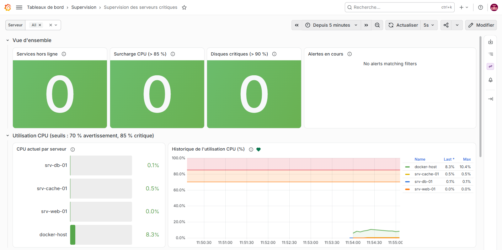
*Le tableau de bord à l'état nominal : synthèse en haut, puis une rangée par indicateur avec ses seuils*

## Sommaire

- [Architecture](#architecture)
- [Démarrage rapide](#démarrage-rapide)
- [Le tableau de bord](#le-tableau-de-bord)
- [Alertes et notifications](#alertes-et-notifications)
- [Tests par injection de panne](#tests-par-injection-de-panne)
- [Calcul des indicateurs](#calcul-des-indicateurs)
- [Pièges rencontrés](#pièges-rencontrés)
- [Limites et pistes](#limites-et-pistes)
- [Structure du dépôt](#structure-du-dépôt)

## Architecture

```
  srv-web-01 (nginx)    srv-db-01 (PostgreSQL)  srv-cache-01 (Redis)   hôte Docker
  1 vCPU, /data 256 Mo  2 vCPU, /data 512 Mo    0,5 vCPU, /data 256 Mo (docker-host)
                                           |   métriques et sondes
                                           v
  +--------------------------------------------------------------------------------+
  | EXPORTEURS  cAdvisor ............ CPU de chaque serveur (cgroups)              |
  |             node_exporter x 3 ... espace disque /data de chaque serveur        |
  |             node_exporter ....... CPU et disque de l'hôte                      |
  |             blackbox_exporter ... sondes HTTP, TCP et PING/PONG des services   |
  +--------------------------------------------------------------------------------+
                                           |   collecte toutes les 5 s
                                           v
  +--------------------------------------------------------------------------------+
  | PROMETHEUS  stockage + règles d'enregistrement (CPU %, disque %)               |
  +--------------------------------------------------------------------------------+
                                           |
                                           v
  +--------------------------------------------------------------------------------+
  | GRAFANA     tableau de bord (seuils, couleurs) + 3 règles d'alerte             |
  +--------------------------------------------------------------------------------+
                                           |   notifications FIRING / RESOLVED
                                           v
                         alert-receiver (webhook d'astreinte)
```

Les serveurs sont simulés par des conteneurs. Pour que chacun se comporte comme une machine
distincte, il reçoit :

- son propre **quota de vCPU**, ce qui permet de saturer un serveur sans toucher aux autres ;
- sa propre **partition `/data` de taille fixe** (volume tmpfs limité). Quand elle est pleine, les
  écritures échouent comme sur un vrai disque. PostgreSQL y stocke réellement ses données ;
- son **agent `node_exporter`**, qui lit cette partition comme l'agent installé sur chaque machine
  d'un parc réel.

| Composant | Image | Rôle |
|---|---|---|
| srv-web-01 / srv-db-01 / srv-cache-01 | `nginx:1.30.6-alpine`, `postgres:18.6-alpine`, `redis:8.6.8-alpine` | Serveurs critiques surveillés |
| agent-web / agent-db / agent-cache | `prom/node-exporter:v1.12.1` | Espace disque de la partition `/data` de chaque serveur |
| node-exporter | `prom/node-exporter:v1.12.1` | CPU et disque de l'hôte Docker |
| cadvisor | `ghcr.io/google/cadvisor:v0.60.6` | CPU de chaque serveur, mesuré par cgroup |
| blackbox | `prom/blackbox-exporter:v0.29.1` | Sondes de disponibilité des services |
| prometheus | `prom/prometheus:v3.15.1` | Collecte toutes les 5 s, règles d'enregistrement, rétention 7 jours |
| grafana | `grafana/grafana:13.2.5` | Tableau de bord, règles d'alerte, notifications (interface en français) |
| alert-receiver | `mendhak/http-https-echo:43` | Destinataire des notifications : journalise chaque alerte reçue |

## Démarrage rapide

**Prérequis** : Docker avec Compose v2 et environ 1,2 Go de RAM libre (dont 900 Mo pour Grafana),
plus la place des partitions `/data` si on les remplit (1 Go au maximum). Les ports `3000` et
`9090` doivent être libres sur `127.0.0.1`.

```bash
cp .env.example .env      # puis choisir les mots de passe Grafana et PostgreSQL
docker compose up -d
docker compose ps         # 12 conteneurs "Up"
```

| Interface | Adresse | Accès |
|---|---|---|
| Grafana | <http://localhost:3000> | `admin` / mot de passe défini dans `.env` |
| Prometheus | <http://localhost:9090> | — |

Le tableau de bord « Supervision des serveurs critiques » s'ouvre directement comme page
d'accueil de Grafana. Les ports ne sont publiés que sur `127.0.0.1`.

Arrêt et nettoyage complet : `docker compose down -v`.

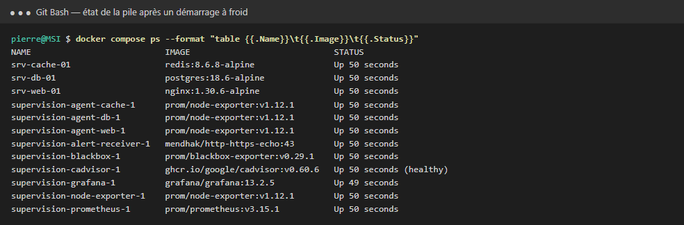
*La pile après un démarrage à froid (`docker compose down -v` puis `up -d`) : tout se reconfigure seul*

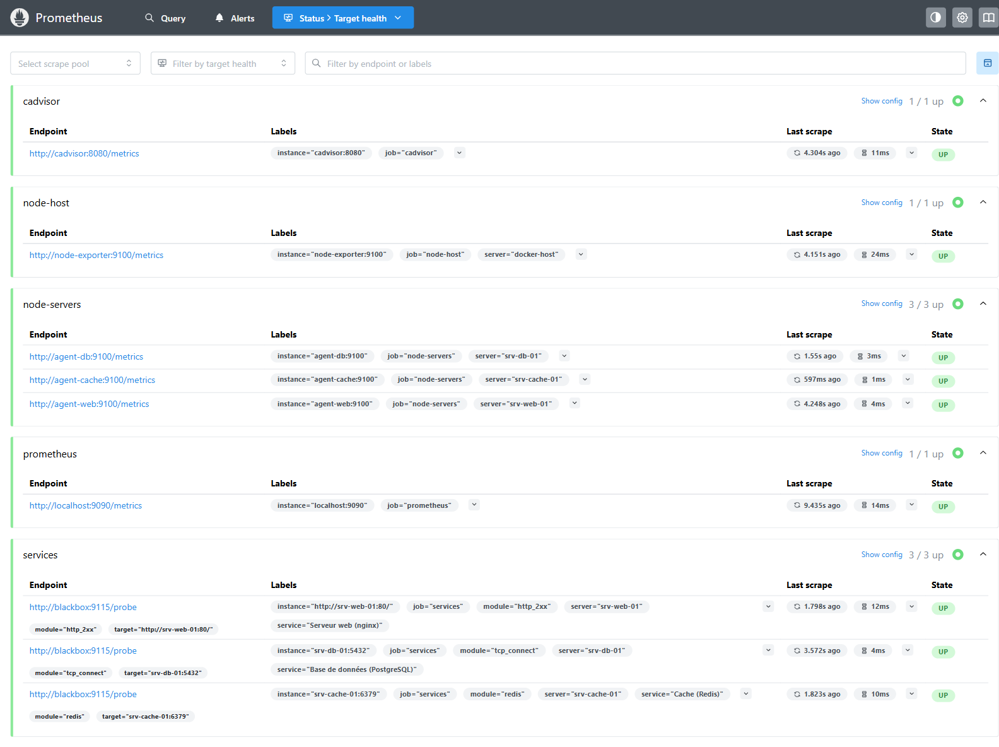
*Les 9 cibles collectées par Prometheus sont « UP »*

## Le tableau de bord

Le tableau de bord est versionné dans `grafana/dashboards/supervision-serveurs.json` et chargé
automatiquement par provisioning. Il se lit de haut en bas :

1. **Vue d'ensemble** : trois compteurs (services hors ligne, serveurs en surcharge CPU, disques
   critiques), verts à 0 et rouges dès 1, et la liste des alertes en cours.
2. **Utilisation CPU** : jauge par serveur et historique sur fond de zones colorées.
3. **Espace disque** : jauge par partition, tableau détaillé (taille, espace libre, % utilisé) et historique.
4. **Services critiques** : état EN LIGNE / HORS LIGNE, frise de disponibilité et détail des sondes.

| Indicateur | Normal | Avertissement | Critique | Alerte |
|---|---|---|---|---|
| CPU | < 70 % | 70 à 85 % | > 85 % | > 85 % pendant 1 min |
| Espace disque utilisé | < 80 % | 80 à 90 % | > 90 % (moins de 10 % libre) | > 90 % pendant 1 min |
| Service | EN LIGNE | — | HORS LIGNE | dès le premier échec |

Pourquoi ces valeurs :

- **CPU** : 70 % laisse une marge pour absorber un pic ; au-delà de 85 % de façon prolongée, les
  temps de réponse se dégradent.
- **Disque** : 80 % laisse le temps d'agir (purge, extension) ; à 90 %, une petite partition peut
  se remplir en quelques minutes avec des journaux ou une sauvegarde.
- **Attente d'une minute** pour le CPU et le disque : un pic bref ne doit pas réveiller l'astreinte.
  Pour un service, aucune attente : une coupure est signalée tout de suite.

Côté interactivité :

- la variable **Serveur** (sélection multiple) filtre tous les panneaux ;
- le rafraîchissement est automatique toutes les 5 s ;
- les tableaux se trient d'un clic sur l'en-tête ;
- chaque panneau a une info-bulle qui explique ce qu'il mesure ;
- les changements d'état des alertes s'affichent en pointillés sur les courbes.

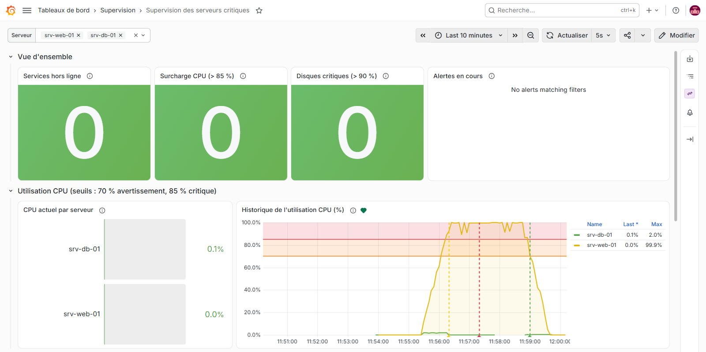
*La variable « Serveur » restreint tout le tableau de bord à srv-web-01 et srv-db-01*

## Alertes et notifications

Trois règles Grafana sont provisionnées dans `grafana/provisioning/alerting/regles.yml` et évaluées
toutes les 10 secondes. Chacune est **multidimensionnelle** : elle produit une alerte distincte par
serveur ou par service, avec un message qui nomme le serveur concerné.

| Règle | Condition | Attente | Message |
|---|---|---|---|
| CPU critique | `server:cpu_usage:percent > 85` | 1 min | CPU critique sur *serveur* |
| Espace disque critique | `server:disk_usage:percent > 90` | 1 min | Espace disque critique sur *serveur* (*partition*) |
| Service hors ligne | `probe_success < 1` | 0 s | Service hors ligne : *service* sur *serveur* |

Les notifications partent vers le point de contact « Astreinte (webhook) »
(`grafana/provisioning/alerting/contact-points.yml`). Ici, le conteneur `alert-receiver` les
reçoit et les journalise. Pour un vrai canal (e-mail, Teams, Slack, PagerDuty), il suffit de
remplacer ce récepteur. Les alertes sont regroupées par règle et par serveur. Pour le CPU et le
disque, un groupe notifie au plus toutes les 30 s, pour ne pas inonder l'astreinte. Les services ont
une route dédiée (attente 1 s, intervalle 10 s) pour être signalés au plus vite.

Pour lire les notifications reçues :

```bash
docker compose logs -t --no-log-prefix alert-receiver | python outils/webhook.py
```

## Tests par injection de panne

Les trois scénarios ci-dessous ont été joués sur la pile en fonctionnement. Les heures viennent de
l'API de Grafana et des journaux du destinataire des notifications.

### Saturation CPU et remplissage disque

```bash
docker exec -d srv-web-01 sh -c 'yes > /dev/null'                               # CPU du serveur web à 100 %
docker exec srv-db-01 dd if=/dev/zero of=/data/remplissage.bin bs=1M count=440     # disque de la base à 94 %
docker exec srv-cache-01 dd if=/dev/zero of=/data/remplissage.bin bs=1M count=215  # disque du cache à 84 %
```

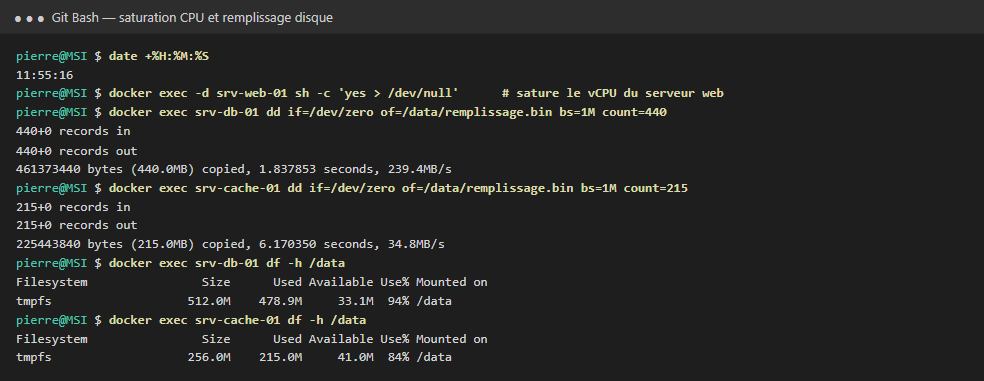

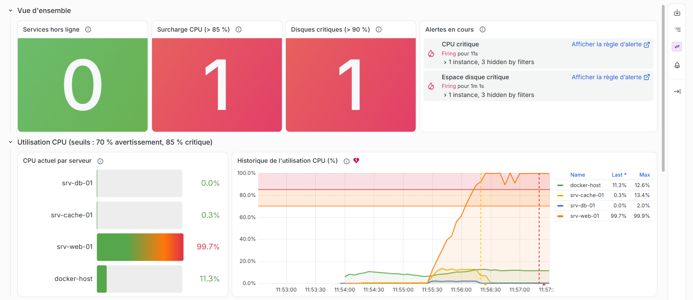
*srv-web-01 à 99,7 % : jauge et courbe dans le rouge, compteurs à 1, alertes « CPU critique » et « Espace disque critique » déclenchées*

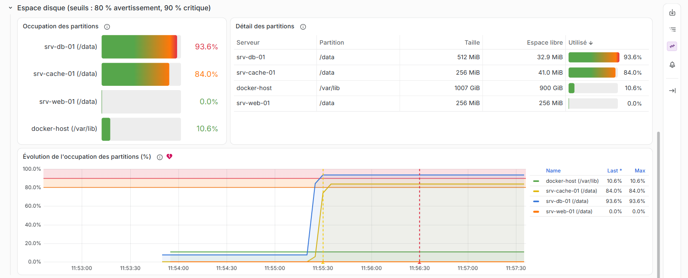
*srv-db-01 à 93,6 % en rouge, srv-cache-01 à 84 % en orange (avertissement, sans alerte)*

### Arrêt de la base de données

```bash
docker stop srv-db-01
```

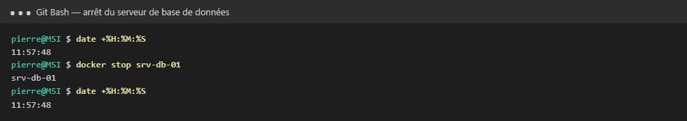

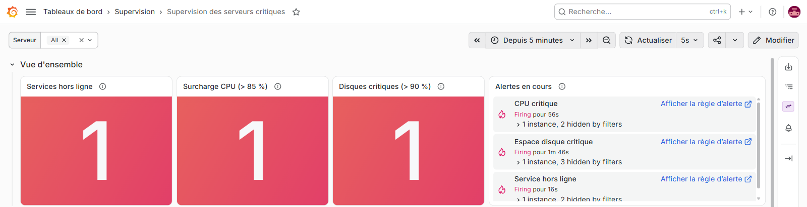
*Les trois compteurs au rouge et les trois alertes listées*

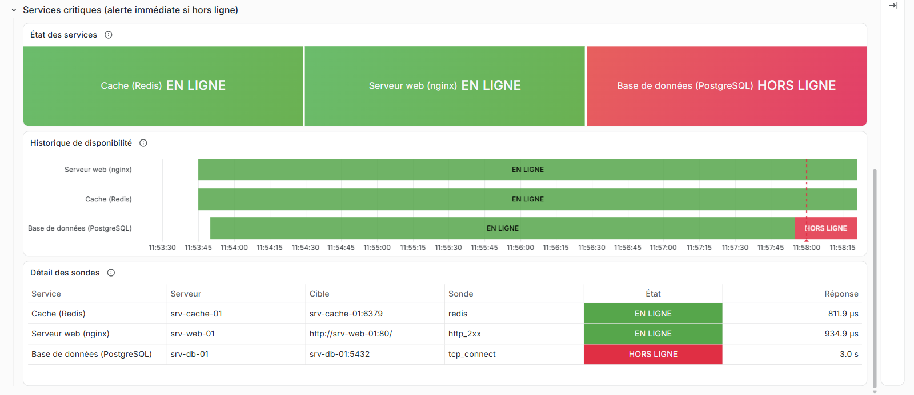
*La base de données passe HORS LIGNE : la sonde échoue au bout de son délai de 3 s*

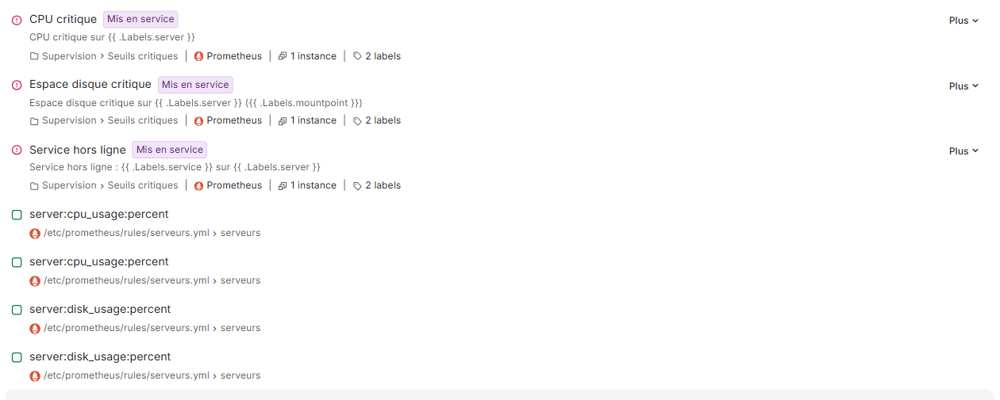
*Les trois règles déclenchées dans Grafana, et les règles d'enregistrement Prometheus en dessous*

### Retour à la normale

```bash
docker start srv-db-01
docker exec srv-web-01 pkill yes
docker exec srv-db-01 rm /data/remplissage.bin
docker exec srv-cache-01 rm /data/remplissage.bin
```

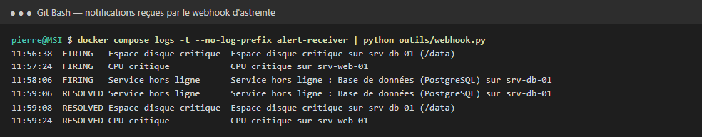
*Une notification FIRING au déclenchement, une notification RESOLVED au retour à la normale*

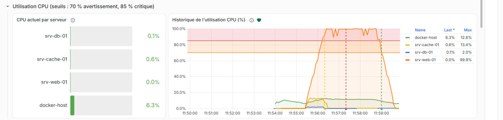
*L'historique garde la trace de l'incident : passage en attente (jaune), déclenchement (rouge), résolution (vert)*

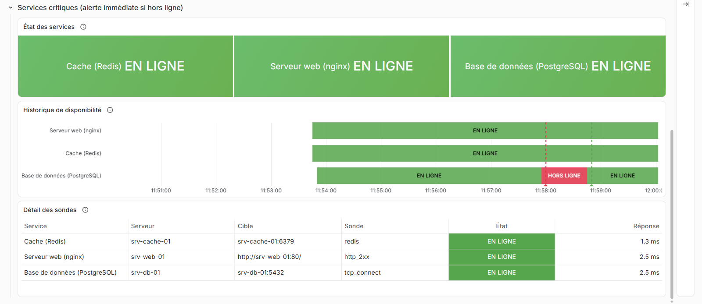
*Tout est revenu EN LIGNE ; la frise conserve la coupure de la base de données*

### Résultats

| Scénario | Début | Alerte déclenchée | Notification reçue |
|---|---|---|---|
| Disque de srv-db-01 rempli à 94 % | 11:55:16 | 11:56:30 (+&nbsp;1&nbsp;min&nbsp;14) | 11:56:38 (+&nbsp;1&nbsp;min&nbsp;22) |
| CPU de srv-web-01 saturé | 11:55:16 | 11:57:20 (+&nbsp;2&nbsp;min&nbsp;04) | 11:57:24 (+&nbsp;2&nbsp;min&nbsp;08) |
| Base de données srv-db-01 arrêtée | 11:57:48 | 11:58:00 (**+&nbsp;12&nbsp;s**) | 11:58:06 (**+&nbsp;18&nbsp;s**) |
| Retour à la normale | 11:58:36 | — | RESOLVED entre +&nbsp;30 et +&nbsp;48&nbsp;s |
| Coupure de srv-cache-01, avec la route dédiée aux services | 12:15:27 | 12:15:30 (**+&nbsp;3&nbsp;s**) | 12:15:36 (**+&nbsp;9&nbsp;s**) |

- **Disque** : l'alerte passe en attente 14 s après le remplissage, puis se déclenche après la
  minute d'attente prévue.
- **CPU** : la moyenne glissante sur 1 min franchit 85 % au bout d'une minute environ, puis
  l'attente d'une minute s'ajoute.
- **Service** : aucune attente. Le délai ne dépend que de la sonde (toutes les 5 s) et de
  l'évaluation (toutes les 10 s). La dernière ligne a été mesurée après l'ajout de la route
  dédiée aux services (voir [Pièges](#pièges-rencontrés)).

## Calcul des indicateurs

Prometheus calcule chaque indicateur par une **règle d'enregistrement**
(`prometheus/rules/serveurs.yml`). Quelle que soit la source, l'indicateur porte un nom unique et
une étiquette `server`. Grafana affiche ainsi tous les serveurs dans un même panneau, avec les mêmes seuils.

| Indicateur | Métrique | Calcul |
|---|---|---|
| CPU d'un serveur | `server:cpu_usage:percent` | temps CPU consommé (cAdvisor) ÷ vCPU alloués × 100 |
| CPU de l'hôte | `server:cpu_usage:percent` | temps CPU actif ÷ temps CPU total compté × 100 (node_exporter) |
| Espace disque | `server:disk_usage:percent` | (1 − espace disponible ÷ taille) × 100 |
| Disponibilité | `probe_success` | 1 si la sonde réussit, 0 sinon |

Pourquoi cAdvisor pour le CPU des serveurs ? Les conteneurs partagent le noyau de l'hôte. Un
`node_exporter` placé dans un conteneur lit `/proc/stat`, c'est-à-dire le CPU de **toute** la
machine. La seule mesure propre à chaque serveur est sa consommation de cgroup, rapportée au quota
qui lui est alloué.

Les sondes de `blackbox/blackbox.yml` vérifient chaque service depuis l'extérieur :

| Service | Sonde | Ce qui est vérifié |
|---|---|---|
| nginx | `http_2xx` | La page d'accueil répond en HTTP 2xx |
| PostgreSQL | `tcp_connect` | Le port 5432 accepte les connexions |
| Redis | `redis` | Redis répond `+PONG` à un `PING` : le protocole est vérifié, pas seulement le port |

## Pièges rencontrés

| Symptôme | Cause | Solution |
|---|---|---|
| `node_exporter` de l'hôte ne démarre pas : *path / is mounted on / but it is not a shared or slave mount* | Docker Desktop refuse la propagation `rslave` sur la racine | Monter `/:/host:ro`, sans `rslave` |
| CPU de l'hôte affiché à 80 % alors que la machine est au repos | Sous WSL2, le temps « idle » des vCPU n'est pas entièrement comptabilisé : la somme des modes ne fait que 8,6 s/s pour 16 vCPU. La formule classique `1 − idle` surestime donc le CPU | Calculer temps actif ÷ temps total compté, une formule qui reste juste même si des compteurs manquent |
| Disque de l'hôte introuvable sur `/var/lib/docker` | Le disque de données de la VM Docker Desktop est monté sur `/var/lib` | Cibler `/var/lib` |
| `$labels` vide dans les messages d'alerte provisionnés | Le provisioning Grafana interprète `$labels` comme une variable d'environnement | Écrire `{{ .Labels.server }}` et `{{ .Values.A.Value }}`, sans `$` |
| La frise de disponibilité affiche « 1+ » au lieu de « EN LIGNE » | Le mode de couleur « seuils » prend le pas sur les correspondances de valeurs | Retirer ce mode : les correspondances portent le texte et la couleur |
| Notification d'un service reçue 30 à 50 s après la coupure, alors que l'alerte se déclenche en quelques secondes | Grafana ne renvoie pas une alerte à son Alertmanager moins de 30 s après le dernier envoi, y compris l'envoi « résolu ». Un groupe qui vient de notifier attend en plus son `group_interval` | Regroupement par serveur et route dédiée aux services (`group_wait` 1 s, `group_interval` 10 s). Une coupure isolée est notifiée en moins de 10 s ; un service qui retombe juste après une alerte peut encore attendre jusqu'à 30 s |
| Tableau de bord modifié mais non rechargé | Les fichiers provisionnés depuis un dossier Windows ne sont pas relus à chaud | `docker compose restart grafana` (l'état des alertes est conservé) |

## Limites et pistes

- **Serveurs simulés** : sur un vrai parc, `node_exporter` serait installé sur chaque machine et le
  CPU calculé directement avec ses compteurs. Les règles d'enregistrement gardent le même nom de
  métrique, donc le tableau de bord ne change pas.
- **Serveur arrêté** : sa jauge CPU disparaît au lieu de passer au rouge. L'arrêt est signalé par
  la rangée Services. Une règle sur `up == 0` signalerait aussi l'agent injoignable.
- **PostgreSQL** : la sonde TCP vérifie que la base accepte les connexions, pas qu'elle répond aux
  requêtes. `postgres_exporter` (métrique `pg_up`) donnerait une vérification au niveau SQL.
- **Anticipation** : une alerte prédictive,
  `predict_linear(node_filesystem_avail_bytes[6h], 24*3600) < 0`, préviendrait la veille d'une saturation.
- **Notifications** : brancher un vrai canal, définir une escalade et des silences pour les maintenances.
- **Superviser la supervision** : une alerte « dead man's switch » préviendrait si Prometheus lui-même tombe.

## Structure du dépôt

```
.
├── compose.yaml                       # 12 services : serveurs, agents, collecte, Grafana
├── .env.example                       # mots de passe à définir (copier en .env)
├── prometheus/
│   ├── prometheus.yml                 # cibles collectées toutes les 5 s
│   └── rules/serveurs.yml             # règles d'enregistrement CPU et disque
├── blackbox/blackbox.yml              # sondes HTTP, TCP et Redis PING/PONG
├── grafana/
│   ├── provisioning/
│   │   ├── datasources/prometheus.yml
│   │   ├── dashboards/dashboards.yml
│   │   └── alerting/
│   │       ├── regles.yml             # 3 règles d'alerte
│   │       └── contact-points.yml     # point de contact webhook + politique de notification
│   └── dashboards/supervision-serveurs.json
├── outils/webhook.py                  # résume les notifications reçues
└── docs/captures/                     # captures de ce README
```
